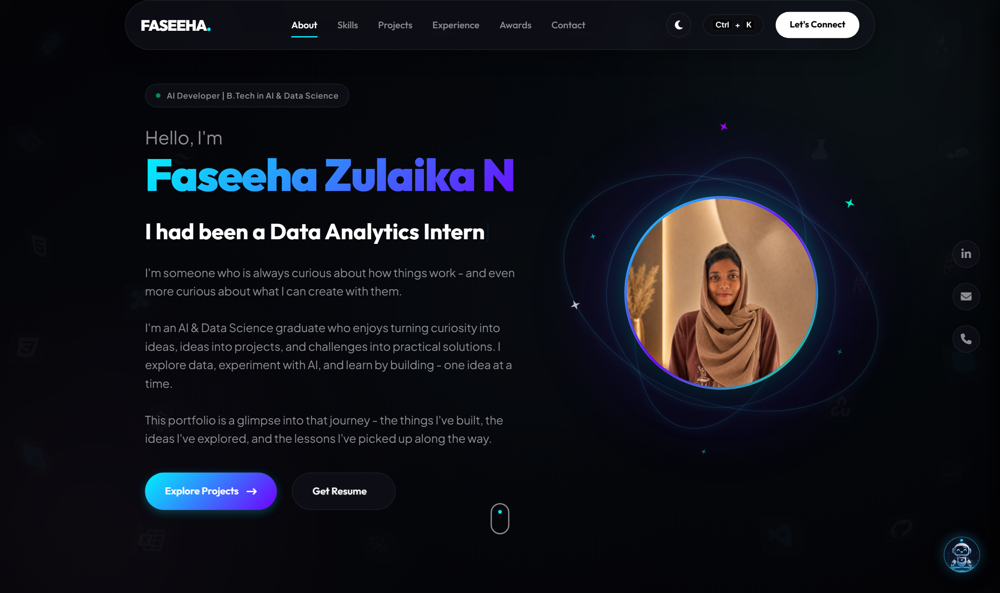

# 🌌 Faseeha Zulaika N — Developer Portfolio

<div align="center">

[](https://fasee9831.github.io/Faseeha-Zulaika-N-Portfolio/)
[](https://github.com/Fasee9831)
[](LICENSE)
[](https://fasee9831.github.io/Faseeha-Zulaika-N-Portfolio/)

<br />

**A futuristic, cyberpunk-inspired developer portfolio featuring interactive 3D card tilt physics, holographic glassmorphism, responsive mobile-first layouts, and an integrated transparent AI assistant mascot.**

[Explore Live Portfolio](https://fasee9831.github.io/Faseeha-Zulaika-N-Portfolio/) · [View Case Studies](#-featured-case-studies--projects) · [Report an Issue](https://github.com/Fasee9831/Faseeha-Zulaika-N-Portfolio/issues)

<br />



</div>

---

## 🌟 Key Features

### 🎴 3D Perspective Card Tilt Physics
- **Desktop Cursor Tracking**: 60fps dynamic 3D perspective rotation along both X and Y axes with elevation lift and cyan/purple ambient glow.
- **Mobile Touch Interaction**: Direct touchstart and touchmove finger tracking with smooth cubic-bezier spring return on release.
- **Device Gyroscope Motion**: Physical device orientation (`deviceorientation`) gently holographic-tilts cards as you tilt your phone in hand.

### 🤖 Animated AI Assistant Mascot
- Custom-rendered robotic mascot with an antialiased transparent alpha channel (`WebM` / `MP4`).
- Interactive floating chat interface with quick actions, terminal aesthetics, and contextual portfolio queries.

### 📱 100% Mobile & Desktop Responsive
- Fluid typography utilizing CSS clamp units.
- Dedicated mobile card gallery layout with proportional 16:9 thumbnails and multi-button action matrices.
- Zero horizontal overflow, preserved desktop design, and smooth Lenis frame-synchronized scrolling.

---

## 🚀 Featured Case Studies & Projects

| Project | Tech Stack | Highlights |
| :--- | :--- | :--- |
| **ZingyByte AI Smart Serve** | `Python` · `Streamlit` · `LangChain` · `RAG` | Real-time AI food concierge with menu retrieval, session history & grounded recommendations. |
| **ZendiMind AI Platform** | `Python` · `NLP` · `Transformers` · `FastAPI` | Real-time sentiment analysis, multi-emotion detection, subjective tone scoring & report exports. |
| **Power BI Analytics Suite** | `Power BI` · `DAX` · `SQL` · `Excel` | 3 interactive dashboards: Spotify Streaming Trends, BigMart Sales Forecasting & Student Performance. |
| **Next-Gen PHOENIX** | `React` · `Node.js` · `AI Integration` | Hybrid online-offline educational network & information exchange ecosystem. |
| **Smart Parking AI Detection** | `Python` · `OpenCV` · `YOLO` | Real-time computer vision parking space occupancy detection and slot tracking. |
| **AuraFaz Fragrance Hub** | `HTML5` · `CSS3` · `JavaScript` | Luxury e-commerce fragrance catalog with dynamic filtering and fluid micro-interactions. |

---

## 🛠️ Tech Stack & Architecture

- **Frontend**: Semantic HTML5, Modern CSS3 (CSS Grid, Flexbox, Custom Properties, Glassmorphism, 3D Transforms)
- **Scripting & Animations**: Vanilla JavaScript (ES6+), GSAP ScrollTrigger, Lenis Smooth Scroll
- **Media & Assets**: Transparent Alpha-channel WebM/MP4, SVG Icons, Font Awesome 6
- **Hosting & CI/CD**: GitHub Pages with automated static deployment

---

## 💻 Local Development Setup

To run this portfolio locally on your machine:

1. **Clone the repository**:
   ```bash
   git clone https://github.com/Fasee9831/Faseeha-Zulaika-N-Portfolio.git
   cd Faseeha-Zulaika-N-Portfolio
   ```

2. **Start a local development server**:
   - Using Python:
     ```bash
     python -m http.server 8000
     ```
   - Using Node.js (`npx`):
     ```bash
     npx serve .
     ```
   - Using VS Code: Right-click `index.html` and select **"Open with Live Server"**.

3. **Open in your browser**:
   Navigate to [http://localhost:8000](http://localhost:8000).

---

## 📬 Contact & Connect

- **Portfolio**: [fasee9831.github.io/Faseeha-Zulaika-N-Portfolio](https://fasee9831.github.io/Faseeha-Zulaika-N-Portfolio/)
- **GitHub**: [@Fasee9831](https://github.com/Fasee9831)
- **Email**: [faseehazulaika@gmail.com](mailto:faseehazulaika@gmail.com)

---

<div align="center">
  <sub>Designed & Developed with 💙 by <b>Faseeha Zulaika N</b>. Built for the future.</sub>
</div>
